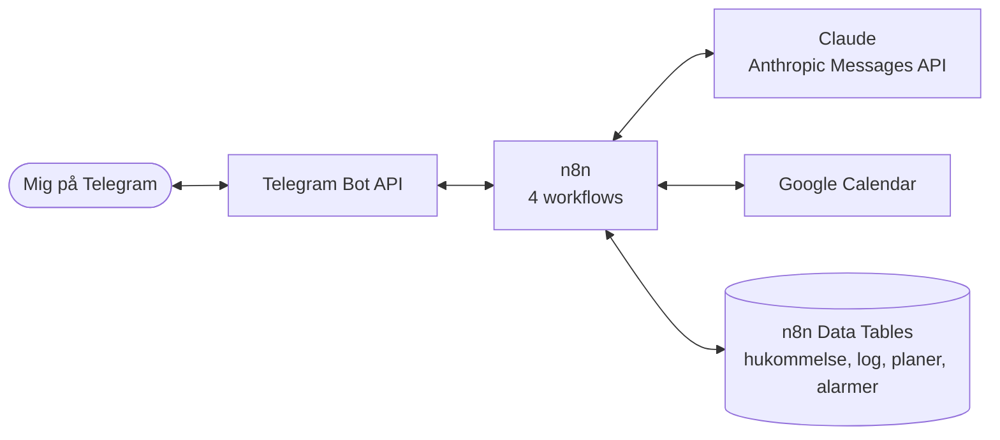

# Personlig AI-assistent i n8n

En personlig assistent, der bor i Telegram og er bygget i n8n med Claude som hjerne og Google Calendar som hukommelse for dagen. Den sender en morgenbrief, hjælper med at lægge dagens todo-liste udenom møderne, spørger om aftenen hvor lang tid tingene faktisk tog, og holder øje med dobbeltbookinger.

Privat hobbyprojekt af Daniel Træholt.

## Hvad den gør

Assistenten består af fire workflows:

| Workflow | Fil | Kører | Hvad den gør |
|---|---|---|---|
| Morgenbrief | [`workflows/morgenbrief.json`](workflows/morgenbrief.json) | Hverdage kl. 06:00 | Henter dagens kalender og gårsdagens uafsluttede opgaver, får Claude til at skrive en kort brief (program, fokus, læring, motivation) og sender den på Telegram. Slutter med en opfordring til at svare med dagens todo-liste. |
| Aftenrefleksion | [`workflows/aftenrefleksion.json`](workflows/aftenrefleksion.json) | Dagligt kl. 18:00 | Opsummerer dagen ud fra kalenderen og beder om tidsfeedback: hvor lang tid tog opgaverne faktisk? Svaret bruges til at kalibrere fremtidige estimater. |
| Interaktiv assistent | [`workflows/interaktiv-assistent.json`](workflows/interaktiv-assistent.json) | Ved hver Telegram-besked | Klassificerer beskeden og handler på den (se nedenfor). |
| Kalender-vagt | [`workflows/kalender-vagt.json`](workflows/kalender-vagt.json) | Hvert 10. minut kl. 06–22 | Scanner de næste 7 dage for overlappende aftaler og sender én Telegram-alarm pr. ny dobbeltbooking. Den flytter ingenting. |

### Den interaktive assistent

Hver besked sendes til Claude sammen med dagens kalender, gemte præferencer, historiske tidsforbrug og en eventuel ventende plan. Claude svarer med JSON og en af fire hensigter:

| Intent | Eksempel | Hvad sker der |
|---|---|---|
| `plan` | "Skal nå: kampagne, 3 mails, forberede møde" | Claude estimerer hver opgave (ud fra historikken), lægger dem i ledige huller udenom møderne og sender et forslag med knapperne **Bekræft / Ret / Drop**. Planen gemmes som `pending`. |
| `confirm` | "ja" | Den ventende plan bliver til Google Calendar-events, hver opgave logges, og der sendes en **Udført**-knap pr. opgave. |
| `actuals` | "kampagnen tog 2 timer, mails 20 min" | Faktisk tidsforbrug skrives på dagens loggede opgaver. |
| `chat` | Alt andet | Almindeligt svar. |

Samtidig kan Claude gemme varige præferencer ("jeg vil helst have dybt arbejde om formiddagen") og slukke for gamle, der ikke længere gælder.

Inline-knapperne håndteres i samme workflow via Telegrams `callback_query`.

## Arkitektur



Claude kaldes direkte via en HTTP Request-node mod `https://api.anthropic.com/v1/messages`. Prompten bygges i en Code-node, så hele konteksten (kalender, hukommelse, kalibrering, ventende plan) er synlig ét sted.

## Datatabeller

Workflows bruger fire n8n Data Tables. Opret dem med disse kolonner:

**`assistant_memory`** – varige præferencer og mønstre

| Kolonne | Type | Note |
|---|---|---|
| `mem_type` | string | `preference`, `pattern` eller `recurring` |
| `content` | string | Selve præferencen |
| `active` | boolean | `false` når Claude har markeret den som forældet |
| `created_at` | string | ISO-tidsstempel |

**`task_log`** – planlagte opgaver og faktisk tidsforbrug

| Kolonne | Type | Note |
|---|---|---|
| `log_date` | string | `yyyy-MM-dd` |
| `task` | string | Opgavenavn |
| `task_type` | string | Fx `email`, `admin`, `studie`, `dyb-arbejde` |
| `estimate_min` | number | Claudes estimat |
| `actual_min` | number | Faktisk tid (fra aftenens feedback) |
| `scheduled_start` | string | ISO-tidspunkt |
| `created_at` | string | ISO-tidsstempel |
| `task_id` | string | Bruges af **Udført**-knappen |
| `done` | boolean | Sat via **Udført**-knappen |

**`pending_plan`** – forslag der venter på bekræftelse

| Kolonne | Type | Note |
|---|---|---|
| `plan_date` | string | `yyyy-MM-dd` |
| `plan_json` | string | Planen som JSON-array |
| `status` | string | `pending` eller `confirmed` |
| `created_at` | string | ISO-tidsstempel |

**`alerted_conflicts`** – dobbeltbookinger der allerede er varslet (så der kun kommer én alarm)

| Kolonne | Type | Note |
|---|---|---|
| `conflict_key` | string | Sorterede event-id'er for de to aftaler |
| `details` | string | Læsbar beskrivelse |
| `alerted_at` | string | ISO-tidsstempel |

## Opsætning

1. **Importér workflows.** I n8n: *Workflows → Import from File*, én JSON-fil ad gangen.
2. **Opret credentials** og vælg dem i de noder, der bruger dem:
   - **Telegram account**: bot-token fra [@BotFather](https://t.me/BotFather).
   - **Anthropic account**: credential-typen *Header Auth* med navnet `x-api-key` og din API-nøgle som værdi.
   - **Google Calendar account**: OAuth2. Workflows bruger kalenderen `primary`.
3. **Opret de fire datatabeller** ovenfor, og vælg dem i alle Data Table-noder (pladsholderne hedder `YOUR_TABLE_ID_...`).
4. **Sæt dit chat-id.** Skriv til din bot og find dit chat-id (fx via `getUpdates`). Erstat `YOUR_TELEGRAM_CHAT_ID` i Telegram-noden i morgenbrief og aftenrefleksion og i Code-noden **Build Alert** i kalender-vagten.
5. **Tjek tidszonen.** Koden regner i `Europe/Copenhagen`. Sæt også workflowets eller instansens tidszone, så cron-tiderne passer.
6. **Aktivér** de fire workflows.

> **Kun ét workflow kan eje bot-webhooken.** Telegram tillader kun én webhook pr. bot. Den interaktive assistent er det eneste workflow med en Telegram Trigger. De andre sender kun beskeder. Hvis du tester et andet workflow med en Telegram Trigger på samme bot, overtager det webhooken, og assistenten holder op med at svare, indtil du genaktiverer den.

## Designvalg

- **Assistentens faste grænser.** Den sender aldrig beskeder eller mails på mine vegne, laver aldrig ændringer i produktionssystemer, og booker eller køber aldrig noget uden godkendelse. Det eneste den skriver til udenfor sine egne tabeller, er min egen kalender, og kun efter et eksplicit "ja" eller et tryk på **Bekræft**. Kalender-vagten advarer kun og flytter intet.
- **Forslag før handling.** En plan gemmes altid som `pending` først. Først ved bekræftelse bliver den til kalenderevents.
- **Kalibrering i stedet for gætteri.** Estimater bygger på gennemsnittet af faktisk tidsforbrug pr. opgavetype. Jo mere aftenfeedback, jo bedre estimater.
- **Struktureret output.** Claude svarer i JSON med `intent`, `reply`, `plan`, `actuals`, `memory_writes` og `memory_deactivate`. Parseren fjerner eventuelle ```-hegn og falder tilbage til `chat`, hvis JSON'en ikke kan læses, så brugeren altid får et svar.
- **Robuste opslag.** Data Table-noder kører med *Always Output Data* og *Execute Once*, så en tom tabel ikke stopper flowet, og opslag ikke ganges op pr. item.
- **Hukommelse uden dubletter.** Prompten viser de eksisterende præferencer og beder Claude om ikke at gentage dem, men i stedet slukke for dem, der er blevet forældede.

## Erfaringer

- **Brug Telegrams gamle `Markdown`, ikke `MarkdownV2`.** MarkdownV2 kræver escaping af tegn som `!`, `.` og `-`, og en enkelt uescapet `!` i Claudes tekst får hele beskeden afvist. Legacy-`Markdown` med `*fed*` er langt mere tilgivende.
- **Bed eksplicit om korrekt dansk med æ, ø og å.** Ellers falder Claude af og til tilbage til `ae/oe/aa`, især når prompten samtidig beder den om at undgå specialtegn af hensyn til Markdown. Alle prompts siger derfor både "skriv korrekt dansk med æ, ø og å" og "undgå KUN ubalancerede Markdown-tegn".
- **Efter en "Answer Callback"-node er `$json` ikke længere trigger-data.** Noden returnerer Telegrams svar på kaldet, så `$json.callback_query` er tom bagefter. Brug i stedet `$('Telegram Trigger').item.json.callback_query`.
- **Hold styr på, hvem der ejer webhooken** (se boksen under Opsætning).

## Kendte begrænsninger

- Prompten beder Claude om tidszonen `+02:00` (sommertid). Om vinteren skal den være `+01:00`, ellers lander blokkene en time forkert.
- Den interaktive assistent svarer alle, der skriver til botten. Tilføj en IF-node efter triggeren, der kun lader dit eget chat-id komme igennem, hvis botten kan findes af andre.
- Planlægning dækker kun i dag.

## Licens

[MIT](LICENSE) © 2026 Daniel Træholt

---

## English summary

A personal AI assistant on Telegram, built in n8n with Claude (Anthropic Messages API), Google Calendar and n8n Data Tables. Private hobby project by Daniel Træholt.

Four workflows:

- **Morning briefing** (weekdays 06:00): today's calendar and yesterday's unfinished tasks, turned into a short brief by Claude.
- **Evening reflection** (18:00): summarises the day and asks how long tasks actually took.
- **Interactive assistant** (Telegram trigger): classifies each message as `plan`, `confirm`, `actuals` or `chat`. It schedules a todo list around existing meetings using calibrated estimates, creates calendar events only after explicit confirmation, logs actual time spent, and keeps a small preference memory.
- **Calendar guard** (every 10 min, 06–22): sends one alert per new double booking. It never moves anything.

Hard limits: the assistant never sends messages or emails on my behalf, never changes production systems, and never books or buys anything without approval.

Lessons learned: use Telegram's legacy `Markdown` parse mode (MarkdownV2 fails on unescaped `!`). Explicitly ask Claude for correct Danish æ/ø/å. After an *Answer Callback* node, read the trigger via `$('Telegram Trigger').item.json.callback_query`. Only one workflow can own a bot's webhook.

To set it up: import the JSON files, create the credentials and the four data tables, replace `YOUR_TELEGRAM_CHAT_ID` and the `YOUR_TABLE_ID_*` placeholders, and activate the workflows.
